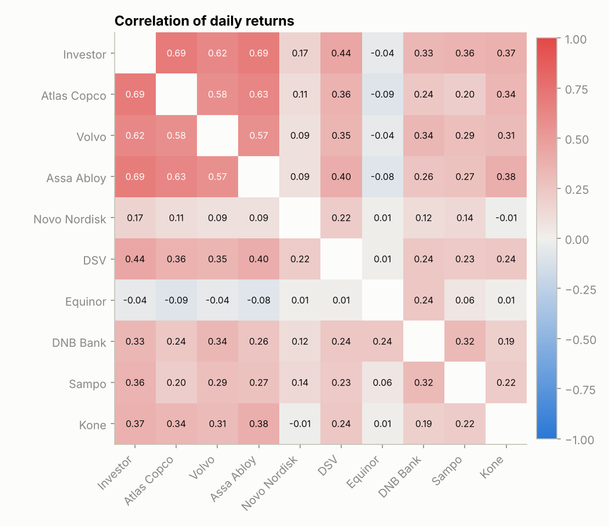

# Nordic Equity Risk Analyzer

**Automated Nordic equity screener and risk-adjusted portfolio optimizer, in SEK.**

**Live dashboard: [nordic-equity-analyser.vercel.app](https://nordic-equity-analyser.vercel.app)**

## Why I built it

Headline returns don't tell you much. A stock that rose 20% with 40% volatility and a 50% drawdown is a very
different holding from one that rose 12% smoothly. This tool ranks 21 Nordic large caps on **risk-adjusted**
return, from the point of view of a **Swedish investor**, and shows how much diversification across the region
could have improved the risk/return trade-off compared with OMXS30.

It comes in two parts:

| | What it is | Stack |
|---|---|---|
| **Web dashboard** (`app/`, `lib/`) | Interactive site: pick stocks, period and risk-free rate; everything recalculates in the browser | Next.js, TypeScript, Recharts, Vercel |
| **Analysis package** (`analysis/`) | The same analysis as a Python package, CLI and Jupyter notebook | Python, pandas, NumPy, yfinance, Matplotlib |

Both implement identical metric definitions, and a shared test fixture (`tests/fixture.json`) checks that the
TypeScript and Python numbers agree to nine decimal places.

## Results: 5 years to 11 Nov 2026 (SEK, rf = 2%)

| | CAGR | Volatility | Sharpe | Sortino | Max DD | Beta |
|:--|--:|--:|--:|--:|--:|--:|
| Investor | 18.0% | 20.2% | 0.81 | 1.18 | −30.6% | 1.05 |
| DNB Bank | 17.1% | 22.5% | 0.72 | 0.99 | −18.2% | 0.57 |
| Volvo | 16.5% | 25.1% | 0.65 | 0.95 | −28.5% | 1.16 |
| Equinor | 20.1% | 34.8% | 0.64 | 0.92 | −40.1% | −0.09 |
| Sampo | 12.7% | 18.8% | 0.62 | 0.87 | −16.0% | 0.43 |
| Assa Abloy | 9.9% | 22.9% | 0.43 | 0.63 | −27.1% | 1.06 |
| Atlas Copco | 8.5% | 29.8% | 0.35 | 0.52 | −42.1% | 1.43 |
| Kone | 5.0% | 29.3% | 0.24 | 0.37 | −33.7% | 0.73 |
| DSV | 1.1% | 32.0% | 0.13 | 0.19 | −39.8% | 0.89 |
| Novo Nordisk | −1.8% | 39.8% | 0.11 | 0.15 | −77.9% | 0.37 |
| *OMXS30 (price index)* | *7.4%* | *16.6%* | *0.39* | *0.56* | *−26.9%* | *1.00* |

**Takeaways**
- Best risk-adjusted performer was **Investor**: index-like beta, but more than double OMXS30's return.
- **Equinor** had the highest CAGR but needed 35% volatility to get it. Its near-zero beta to OMXS30 makes it a
  strong diversifier, which is why the optimiser gives it a large weight.
- **Novo Nordisk** went from star to worst performer: a 78% drawdown in SEK. Its frontier dot sits at about +7%
  "expected" (arithmetic) return despite a negative CAGR. The gap is volatility drag.
- The max-Sharpe mix (Investor, Equinor, Sampo, DNB, Volvo) reached a Sharpe of about 1.1 at lower volatility than
  OMXS30, but those weights were chosen with hindsight (see Limitations).




## What it does

1. **Collects data**: daily adjusted closes (dividends reinvested) for 21 large caps across Stockholm,
   Copenhagen, Oslo and Helsinki, plus OMXS30 and DKK/NOK/EUR→SEK FX rates, from Yahoo Finance.
2. **Cleans it properly**:
   - **SEK conversion.** A Swedish investor holding Novo Nordisk carries DKK risk, so returns are measured in SEK.
   - **Calendar alignment.** The four exchanges close on different holidays. Prices are forward-filled across a
     closed market's holiday instead of `dropna()`, which would silently delete every country's holidays
     from every stock.
3. **Computes risk metrics** for each stock: CAGR, annualised volatility, Sharpe, Sortino, max drawdown and beta to OMXS30.
4. **Screens and ranks** on any of them (Sharpe by default).
5. **Optimises a portfolio**: samples 4,000+ long-only portfolios to draw the efficient frontier and find the
   max-Sharpe and min-volatility mixes, then backtests them against OMXS30.
6. **Visualises**: growth-of-1-SEK chart, efficient frontier, portfolio weights and a correlation heatmap.

## Methodology

| Metric | Definition |
|---|---|
| CAGR | `(P_end / P_start)^(1/years) − 1`, years measured in calendar days / 365.25 |
| Volatility | sample std. dev. of daily returns × √252 |
| Sharpe | mean daily excess return ÷ std. dev. of daily returns × √252; rf converted to a daily rate geometrically |
| Sortino | as Sharpe, but dividing by downside deviation (returns below rf only) |
| Max drawdown | largest peak-to-trough fall in the price series |
| Beta | cov(stock, OMXS30) ÷ var(OMXS30), daily returns |

**A common mistake avoided:** `mean(daily return) × 252` is an *arithmetic* annual return, not CAGR. With
volatile returns it overstates real growth: +60% followed by −50% has a positive arithmetic mean but loses
money. The unit tests include exactly this case.

**Optimiser.** Long-only, fully invested mean-variance portfolios drawn by seeded Monte Carlo sampling (flat
Dirichlet, plus sharpened samples to reach the concentrated edges of the frontier). With 20+ stocks, random
samples thin out near the optimum, so the best max-Sharpe and min-volatility samples are polished with a local
search that shifts weight between pairs of stocks. Sampling keeps the method transparent and draws the whole
feasible set, which a quadratic solver would not.

**Calendar detail.** FX trades on Sundays; equities don't. The trading calendar is built from equity dates
only (FX is forward-filled onto it), otherwise every stock would get fake zero-return Sundays that understate
volatility and correlation.

### Limitations (read before drawing conclusions)

- **In-sample.** The max-Sharpe weights are chosen with hindsight on the same data they're evaluated on, so the
  backtest flatters them. A walk-forward test (fit on one window, evaluate on the next) is the natural next step.
- **Survivorship bias.** The universe is today's large caps.
- **Benchmark.** OMXS30 (`^OMX`) is a price index, so it excludes dividends, while stock returns include them.
  This understates the benchmark by roughly its dividend yield.
- **Risk-free rate** is a single user-set assumption (default 2%), not a historical rate series.
- No transaction costs, taxes or FX hedging. Not investment advice.

## Run it yourself

**Web dashboard**

```bash
npm install
npm run dev              # http://localhost:3000, live Yahoo data
MOCK_DATA=1 npm run dev  # offline, synthetic prices
npm test                 # unit tests + cross-check against the Python numbers
```

**Python analysis**

```bash
cd analysis
pip install -r requirements.txt
python main.py                 # prints the ranked table, saves charts + metrics.csv to docs/
python main.py --period 3y --all --rf 0.025
jupyter notebook notebook.ipynb
pytest
```

## Project structure

```
universe.json            stock list shared by both implementations
app/                     Next.js pages + /api/prices (cached Yahoo Finance proxy)
components/Dashboard.tsx UI and charts
lib/metrics.ts           risk metrics, calendar alignment, SEK conversion
lib/optimizer.ts         Monte Carlo mean-variance optimiser
analysis/nordic_screener Python package: data.py, metrics.py, optimizer.py, plots.py
analysis/main.py         CLI
analysis/notebook.ipynb  walkthrough notebook
tests/                   TypeScript tests + shared fixture
```

## Ideas for next steps

- Walk-forward (out-of-sample) backtest of the optimiser
- Total-return benchmark (OMXS30 GI) and a historical risk-free series (STIBOR / Swedish T-bills)
- Factor exposures (size, value, momentum) for each stock
- Covariance shrinkage (Ledoit-Wolf) for more stable weights

---
Built with Python, TypeScript and Claude Code. Data from Yahoo Finance, for education and demonstration only.
