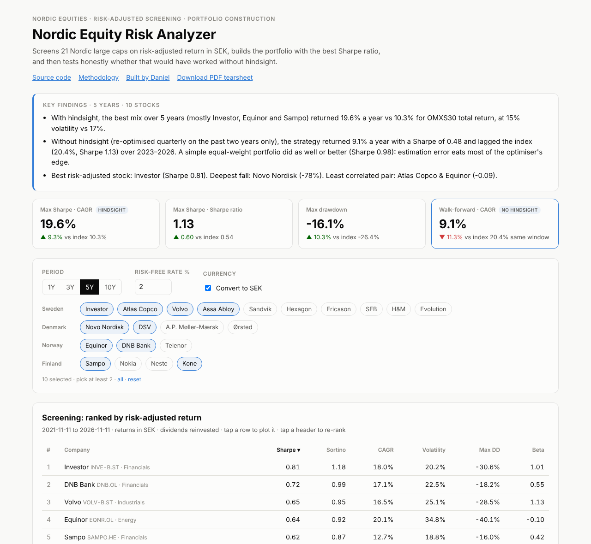
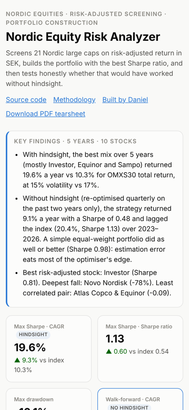
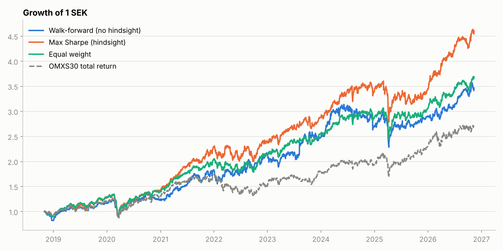
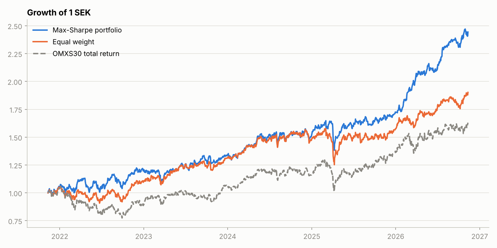
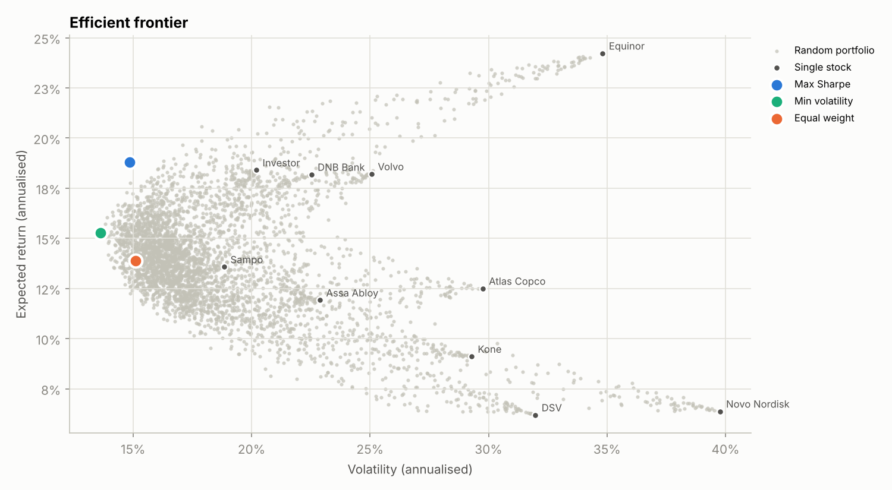

# Nordic Equity Risk Analyzer

[](https://github.com/danielengerby1/Nordic-Equity-Analyser/actions/workflows/tests.yml)

**Screens 21 Nordic large caps on risk-adjusted return in SEK, builds a max-Sharpe portfolio, and then tests
honestly whether that would have worked without hindsight.**

**Live dashboard: [nordic-equity-analyser.vercel.app](https://nordic-equity-analyser.vercel.app)**

<p>
  
  
</p>

## The question

Headline returns don't tell you much. A stock that rose 20% with 40% volatility and a 50% drawdown is a very
different holding from one that rose 12% smoothly. This project asks two things:

1. **Which Nordic large caps delivered the best return per unit of risk, for a Swedish (SEK) investor?**
2. **Does mean-variance optimisation beat simple diversification once you remove hindsight?**

## Key findings (data to 11 Nov 2026, SEK, risk-free rate 2%)

**1. With hindsight, optimisation looks spectacular.** Over 5 years, the max-Sharpe mix of 10 default stocks
(mostly Investor, Equinor and Sampo) returned 19.6% a year with a Sharpe of 1.13. OMXS30 total return did
10.3% with a Sharpe of 0.54.

**2. Without hindsight, most of that edge disappears.** Re-optimising every quarter using only the previous two
years of data (a walk-forward test):

| Out of sample, Nov 2018 – Nov 2026 (10y data) | CAGR | Volatility | Sharpe | Max DD |
|:--|--:|--:|--:|--:|
| **Walk-forward max Sharpe (no hindsight)** | **16.7%** | 19.0% | **0.80** | −27.2% |
| Max Sharpe with hindsight | 21.0% | 17.8% | 1.04 | −34.8% |
| Equal weight | 17.7% | 16.8% | 0.93 | −34.0% |
| OMXS30 total return | 13.4% | 18.0% | 0.67 | −31.8% |

| Out of sample, Oct 2023 – Nov 2026 (5y data) | CAGR | Volatility | Sharpe | Max DD |
|:--|--:|--:|--:|--:|
| **Walk-forward max Sharpe (no hindsight)** | **9.1%** | 16.9% | **0.48** | −26.8% |
| Max Sharpe with hindsight | 23.8% | 13.1% | 1.53 | −16.1% |
| Equal weight | 15.5% | 13.6% | 0.98 | −20.6% |
| OMXS30 total return | 20.4% | 15.7% | 1.13 | −21.7% |

Over the longer window the strategy beat the index, but **a naive equal-weight portfolio did better in both
windows**. Expected returns estimated from two years of noisy data make the optimiser chase recent winners. This
is the well-known result of DeMiguel, Garlappi & Uppal (2009), reproduced here on Nordic data.



**3. Stock-level picture (5 years):**

| | CAGR | Volatility | Sharpe | Sortino | Max DD | Beta |
|:--|--:|--:|--:|--:|--:|--:|
| Investor | 18.0% | 20.2% | 0.81 | 1.18 | −30.6% | 1.01 |
| DNB Bank | 17.1% | 22.5% | 0.72 | 0.99 | −18.2% | 0.55 |
| Volvo | 16.5% | 25.1% | 0.65 | 0.95 | −28.5% | 1.13 |
| Equinor | 20.1% | 34.8% | 0.64 | 0.92 | −40.1% | −0.10 |
| Sampo | 12.7% | 18.8% | 0.62 | 0.87 | −16.0% | 0.42 |
| Assa Abloy | 9.9% | 22.9% | 0.43 | 0.63 | −27.1% | 1.02 |
| Atlas Copco | 8.5% | 29.8% | 0.35 | 0.52 | −42.1% | 1.38 |
| Kone | 5.0% | 29.3% | 0.24 | 0.37 | −33.7% | 0.69 |
| DSV | 1.1% | 32.0% | 0.13 | 0.19 | −39.8% | 0.85 |
| Novo Nordisk | −1.8% | 39.8% | 0.11 | 0.15 | −77.9% | 0.35 |
| *OMXS30 total return* | *10.3%* | *17.0%* | *0.54* | *0.77* | *−26.4%* | *1.00* |

- **Investor** had the best risk-adjusted return: index-like beta with almost double the index's CAGR.
- **Equinor** barely moves with OMXS30 (beta −0.10), so the optimiser leans on it as a diversifier.
- **Novo Nordisk** fell 78% from peak in SEK. On the frontier it still shows about +7% "expected" (arithmetic)
  return despite a negative CAGR: that gap is volatility drag.

<p>
  
  
</p>

## What the dashboard does

- **Key findings** written out in plain English for whatever stocks and period you pick
- **Screening table** ranked by Sharpe, Sortino, CAGR, volatility, max drawdown or beta, in SEK or local currency
- **Growth of 1 SEK** for the max-Sharpe, equal-weight and your own portfolio against OMXS30 total return
- **Build your own portfolio** with sliders and live metrics
- **Out-of-sample backtest** as above, plus the weights the strategy would hold today
- **Stress test**: how each portfolio did during the index's worst drawdowns (COVID 2020, 2022, April 2025)
  and by calendar year
- **Efficient frontier**, optimal weights and a **correlation heatmap**
- **PDF tearsheet**: a three-page print-ready summary
- Works on phones, and link previews show live numbers

## Methodology

| Metric | Definition |
|---|---|
| CAGR | `(P_end / P_start)^(1/years) − 1`, years measured in calendar days / 365.25 |
| Volatility | sample std. dev. of daily returns × √252 |
| Sharpe | mean daily excess return ÷ std. dev. of daily returns × √252; rf converted to a daily rate geometrically |
| Sortino | as Sharpe, but dividing by downside deviation (returns below rf only) |
| Max drawdown | largest peak-to-trough fall |
| Beta | cov(stock, benchmark) ÷ var(benchmark), daily returns |

**Data.** Daily adjusted closes (dividends reinvested) from Yahoo Finance, converted to SEK with daily
DKK/NOK/EUR rates. A Swedish investor holding Novo Nordisk carries DKK risk, so that is included.

**Benchmark.** OMXS30 total return, using the accumulating Xact OMXS30 ETF (dividends reinvested, 0.10% fee).
Yahoo's history for the ETF has gaps in 2017–2019, so when coverage is below 97% the benchmark uses the index's
daily moves plus a constant dividend drift calibrated to the ETF's own growth. The price index alone would
understate the benchmark by its ~3% dividend yield.

**Trading calendar.** The four exchanges close on different holidays, so prices are forward-filled across a
closed market's holiday instead of `dropna()`, which would silently delete every country's holidays from every
stock. The calendar is built from equity dates only: FX trades on Sundays, and including those dates added fake
zero-return days that understated volatility (a bug found and fixed while testing on live data).

**CAGR, not arithmetic return.** `mean(daily return) × 252` overstates growth when returns are volatile:
+60% then −50% has a positive arithmetic mean but loses money. The unit tests include exactly this case.

**Optimiser.** Long-only, fully invested mean-variance portfolios: seeded Monte Carlo sampling (flat Dirichlet,
plus sharpened samples for the concentrated edges), then a local search that polishes the best samples. Without
the polish, adding stocks made the reported optimum *worse*, which is impossible at the true optimum.

**Walk-forward test.** A 504-trading-day (≈2-year) estimation window, re-optimised every 63 days (≈quarterly),
with weights held and rebalanced daily in between. A unit test checks that changing future returns cannot change
an earlier decision.

### Limitations

- **Survivorship bias.** The universe is today's large caps.
- **Risk-free rate** is a single assumption (default 2%), not a historical rate series.
- No transaction costs, taxes or FX hedging. For education only, not investment advice.

## Engineering

| | What it is | Stack |
|---|---|---|
| **Web dashboard** (`app/`, `components/`, `lib/`) | Interactive site; all analysis runs in the browser | Next.js, TypeScript, Recharts, Vercel |
| **Analysis package** (`analysis/`) | The same analysis as a Python package, CLI and Jupyter notebook | Python, pandas, NumPy, yfinance, Matplotlib |

The two implementations share `universe.json` and are tested against a shared fixture (`tests/fixture.json`)
so their metrics agree to nine decimal places. Both test suites run on every push (GitHub Actions).

```bash
# Web dashboard
npm install
npm run dev                          # http://localhost:3000, live Yahoo data
PRICES_DIR=./snapshot npm run dev    # serve prices_<range>.json snapshots offline
MOCK_DATA=1 npm run dev              # synthetic prices
npm test

# Python analysis
cd analysis
pip install -r requirements.txt
python main.py                       # ranked table, charts and metrics.csv in docs/
python main.py --period 10y --all --rf 0.025
jupyter notebook notebook.ipynb      # walkthrough incl. the walk-forward test
pytest
```

```
universe.json             stock list shared by both implementations
app/                      Next.js page, /api/prices (cached Yahoo proxy), link-preview image
components/               dashboard, charts and sections
lib/metrics.ts            risk metrics, calendar alignment, SEK conversion
lib/optimizer.ts          Monte Carlo + local-search mean-variance optimiser
lib/backtest.ts           walk-forward backtest
lib/stress.ts             drawdown episodes, calendar-year returns
lib/analyze.ts            pipeline, total-return benchmark, key findings
analysis/nordic_screener  Python package (data, metrics, optimizer, backtest, plots)
tests/                    TypeScript tests + shared fixture
```

## Next steps

- Covariance shrinkage (Ledoit-Wolf) and return shrinkage, to see if they close the gap to equal weight
- A historical risk-free series (Swedish T-bills) instead of a constant
- Factor exposures (size, value, momentum) for each stock

---
Built by [Daniel Engerby](https://www.linkedin.com/in/danielengerby/) with Python, TypeScript and Claude Code.
Data from Yahoo Finance, for education and demonstration only.
